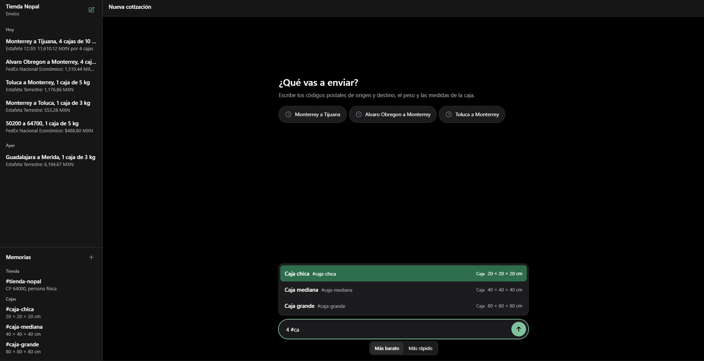
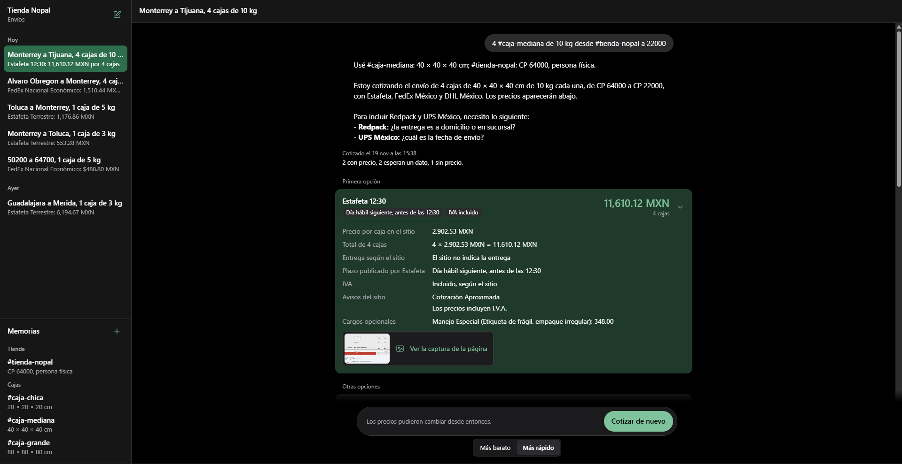
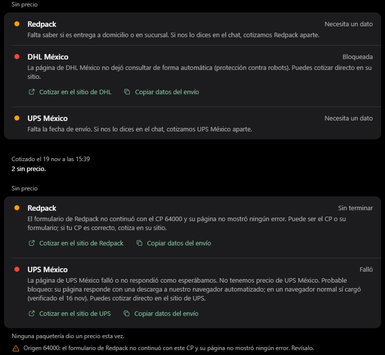
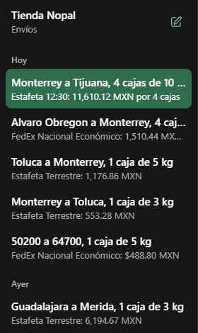

# QuoteBot for Tienda Nopal

_About 3 h 40 min of focused work._

**QuoteBot is the proof; the architecture is what I'd keep.** Every site is a data plugin, the model does only what needs judgment, and code checks every fact against the page before Mariana sees it. A new carrier is a new data file, and any business that still copies prices out of websites can reuse the same loop.

## What was wrong, in the order I fixed it
1. **It couldn't be trusted:** tools said "ok" on failure (25 of 38 actions failed unseen); the prompt said to estimate prices, solve captchas and book. First, because every number depends on it.
2. **Nothing was measured:** 0 of 3 cases, $3.80, 82–94% of tokens spent on HTML dumps.
3. **It couldn't reach the forms** (Estafeta's lives in an iframe).
4. **No comparison:** one carrier at a time, no status per carrier.

## The architecture
- **Sites are data, not code.** A carrier plugin holds its start page, recon notes, required fields, budget, known doubts and published delivery terms. Carriers run in parallel. Memorias plugs the user's own context into the same contract (`list`, `resolve`).
- **Two models, rules in code.** Haiku 5.5 talks and asks only what's missing; Opus 5.5 fills each site with tools that observe before acting and return real errors. Units, totals in integer cents, ranking and deadlines are code.
- **Trust is enforced in code, not asked of the model.** A price exists only if its text is on the captured page, with a screenshot; so do site notes, charges, FedEx's VAT breakdown and delivery dates. VAT is "included" only when the site says so. Amounts are stripped from everything the model writes. Code detects blocks, closes carriers on caps, and calls a postal code rejected only when the site does.
- **One append-only record per quote** drives the UI, the history, replay without site traffic, the scorecard and the tests.

**Built on her words:** "a minute, not ten" → live progress per carrier; "cheapest isn't best" → cheapest, fastest or on time; "IVA" → as each site states it; "I paid the difference" → the evidence behind every number. A blocked carrier gets one click to its quote page and one to copy the shipment data.

**Deliberately not done:** nothing against bot protection (DHL is reported as blocked; UPS, which answers with a file download, as failed); no calls to the pages' own rate requests (a screenshot is easier for Mariana to check); no computed VAT.

## Before / after
`npm run score` grades every recorded run against `expect` (G1 no unread price, G2 evidence per price, G3 no false claims, G4 a status per carrier), with time and cost. Records in `results/`.

| Case | Before (starter) | After (final code, live) |
|---|---|---|
| 5: "mañana en Puebla", data missing | fail, 1:14, $0.53 | pass: asks for the postal code and box, ranks by tomorrow's deadline; FedEx next-day arrives tomorrow per its site. 2:58, $0.44 |
| 6: compare 3 carriers | fail, 1:37, $2.75 | pass: 10 prices from the carriers she named, DHL reported as blocked. 2:47, $0.33 |
| 7: 4 identical boxes | fail, 1:14, $0.52 | pass: 10 prices, totals for 4 boxes computed in code. 2:38, $0.37 |
| 1: simple quote | not run | pass: 11 prices with evidence; Redpack and UPS ask for their data. 2:47, $0.36 |
| 9: postal code 99999 | not run | pass: no site accepts it, no price, asks her to confirm it. 2:03, $0.27 |

Hidden tool errors: 25 of 38 → 0. About 85 carrier visits in total: one attempt per site, no retries.

## Feature: Memorias (#tags), for Mariana and her assistant
"Most of my boxes are one of three sizes": she saves her store and boxes once, then writes "4 #caja-mediana de 10 kg desde #tienda-nopal a 22000".
- **Code resolves each #tag before the model reads it,** so a postal code or size can't be misremembered; the reply names the values used.
- **Nothing is invented:** an empty slot makes the bot ask; delivery type and ship date are never saved.
- **Same trust rules as quotes:** every change is an event, and each quote keeps the values it used.

Memorias is the small feature; the larger one is the parallel engine itself: one agent per carrier, all at once, each closed by code, so a blocked site never holds up the rest. Considered: a WhatsApp reply (trust in the number first; see Future), price alerts (recurring site traffic), saved routes (recent ones are one tap away).

## How I used AI
Claude (planning, review) and Claude Code (code) did most of the writing; I set the direction, reviewed every diff and graded every run. **Rejected:** deterministic per-carrier scripts. The model fills forms and trust lives in code, so a new carrier is data. **Caught in review:** Estafeta 12:30 ranked last on "fastest"; the fix made delivery text verified like prices.

## Next (each fits the time left, but not with the tests and live runs to ship it verified)
1. Faster FedEx (about 2:15): its own rate request, one shared browser.
2. DHL and UPS through the two paths the README allows, each disclosed.
3. Tie each FedEx date to its own service block.
4. Close the amount-filter gaps ("350" with no currency).
5. Holidays and pickup cutoffs in published delivery terms.

## Future: what the core makes possible (details in `docs/FUTURE.md`)
- **A richer engine:** agents that hand work to each other (quote → customer → follow-up), each with its own budget and record, reading only what was verified.
- **A customer agent that closes the loop** on WhatsApp and email: it asks customers for exactly what the quote still needs, and says nothing the record can't back.
- **A companion, not a price machine:** a prompt that knows her business through Memorias and suggests ("a gift: FedEx next-day arrives on time"); numbers still come from code.
- **Always on, with its own computer:** cloud agents quote and follow up while she sleeps, at the autonomy she sets (suggest, draft for approval, act on routine cases), under limits that are already code.
- **Self-improving and scalable:** repeated failures become plugin changes a person approves; a carrier is a data file, a store its own records, any niche without APIs the same loop.

_Time set how much could be polished, not how far this goes. The slow part, foundations an agent can be trusted on, is in place; the rest is time to build more than Mariana thinks she needs._

**Run:** `npm run dev` (`REPLAY_RUN=<record>` replays a quote) · `npm run score` · `npx playwright show-trace results/traces/dhl-blocked/dhl.trace.zip`.

 
 
